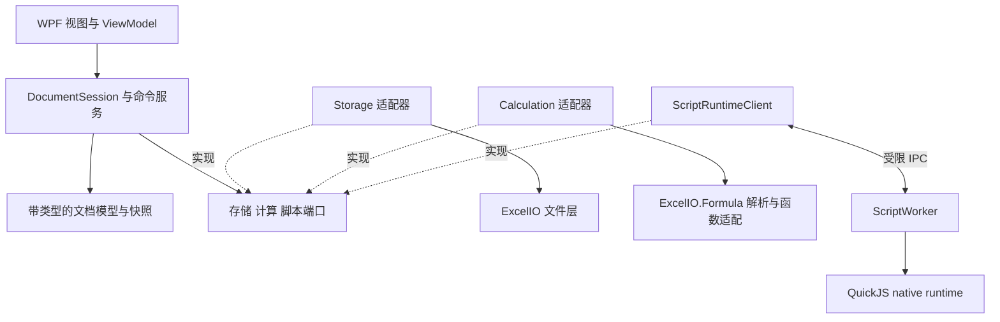
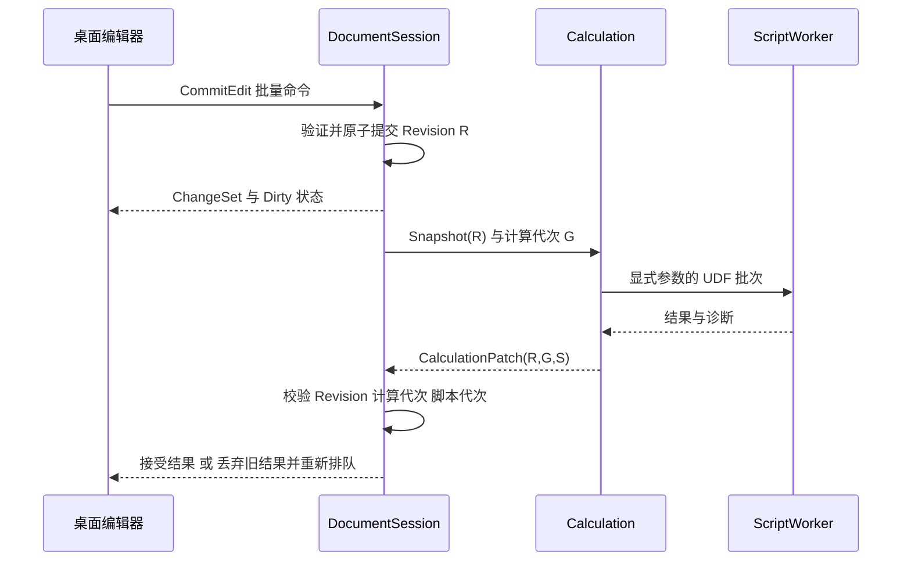

# QuickExcel 系统架构

本设计将当前原型演进为分层桌面应用。WPF 负责交互与呈现；每个文档会话拥有唯一的写入队列；计算与文件操作使用一致快照；QuickJS 通过受控接口执行函数和操作脚本。内存中的带类型模型是编辑事实来源，持久化时 `workbook.xlsx` 是 XLSQ 包内单元格内容的唯一事实来源。

## 当前实现与演进起点

| 当前代码 | 当前职责与限制 | 演进方式 |
| --- | --- | --- |
| [MainWindow.xaml.cs](../MainWindow.xaml.cs) | 界面、编辑、撤销、保存、调度与 smoke 集中在窗口 | 提取 ViewModel、EditorController、命令服务和独立 UI 验收入口 |
| [WorkbookDocument.cs](../../QuickExcel.Core/WorkbookDocument.cs) | 文档、JS 注册与同表重算；直接使用可变 XlWorkbook | 保留过渡 facade，逐步转发到 DocumentSession 与新领域模型 |
| [DocumentPackage.cs](../../QuickExcel.Core/DocumentPackage.cs) | ZIP、原子保存、容量校验、稀疏坐标补偿 | 迁入存储适配器，拆分格式与恢复职责 |
| [QuickJsSession.cs](../../QuickExcel.Scripting/QuickJsSession.cs) | 进程内 native QuickJS、标量调用、限制和日志 | 封装运行时接口，再移入 ScriptWorker |
| [ExcelIO.Formula](../../ExcelIO.Formula/ExcelIO.Formula.csproj) | 解析器、内置函数和旧计算引擎 | 先复用解析与函数；typed evaluator、重算图逐步统一到 Calculation |
| [XlCell.cs](../../ExcelIO/XlCell.cs) | 字符串值、公式、静态变更回调 | 作为旧库兼容模型，停止承担新编辑器的唯一数据模型 |

原型的同表调度和旧 `FormulaEngine.Calculate` 不是同一个调度器。目标中只有一个工作簿级调度器负责计算提交，避免两套状态同时生效。ExcelIO 仍维持独立读写库，不因桌面或 QuickJS 引入 WPF/native 依赖。

## 模块和依赖

以下为目标模块。先在现有项目内按命名空间和接口建立边界；只有存在明确编译依赖或独立测试需求时再拆项目。表中的箭头表示允许的编译引用。

| 模块或目标项目 | 负责 | 允许依赖 |
| --- | --- | --- |
| QuickExcel.Domain | 类型、地址、稀疏存储、样式、快照、变更集 | .NET 基础库 |
| QuickExcel.Core | DocumentSession、命令队列、撤销、保存协调；定义存储/计算/脚本端口 | Domain |
| QuickExcel.Calculation | AST 适配、typed evaluator、函数目录、依赖图与调度 | Core 端口、Domain；过渡期 ExcelIO.Formula |
| QuickExcel.Storage | XLSQ、XLSX、格式迁移、恢复草稿、损失报告 | Core 端口、Domain、ExcelIO |
| QuickExcel.ScriptContracts | IPC 和脚本值 DTO、版本与错误代码 | .NET 基础库；不得引用 WPF、ExcelIO 或 native runtime |
| QuickExcel.Scripting | 桌面侧运行时客户端与 worker 管理；原生适配器作为内部组件 | Core 端口、Domain、ScriptContracts |
| QuickExcel.ScriptWorker | 可执行的 JS 宿主，native 资源与消息循环 | ScriptContracts、Scripting 的原生适配子模块 |
| QuickExcel.Desktop | WPF、ViewModel、网格、编辑器、文件对话框、启动组合 | Core、Domain；仅启动组合代码引用具体适配器 |

若 Scripting 拆出 `QuickExcel.Scripting.Native`，该子模块仅引用 ScriptContracts，不反向引用 Core；Worker 引用这个子模块，不引用桌面侧客户端。这样进程启动、协议和 native 引擎不存在循环引用。



图中的运行时调用通过端口注入。Core 不直接构造 native runtime、文件对话框或 WPF 控件。第一阶段使用手动组合即可，依赖注入容器不是前置要求。

## 带类型的文档模型

`CellValue` 采用显式联合类型：`Blank`、`Number`、`Text`、`Boolean`、`Error`。`Number` 使用有限的 IEEE 754 double；NaN/Infinity 转为明确错误。文本 `00123` 和数字 `123` 不得因显示相似而合并，空白与空字符串也保持区别。

日期采用数值序列、数字格式和工作簿日期系统的组合；日期输入和 JS 日期辅助 API 显式转换，不把所有看起来像日期的文本自动转换。1900/1904、闰日兼容和时区无关语义由格式与计算层共同测试。

建议实体边界：

```text
WorkbookModel
  DocumentId, Revision, DateSystem, SheetOrder
  Sheets: SheetId -> WorksheetModel
  Styles: StyleId -> immutable StyleDefinition
  Names: scope + identifier -> reference/expression

WorksheetModel
  SheetId, DisplayName, SparseCells, RowMetadata, ColumnMetadata
  Merges, Images, ViewMetadata

CellContent
  Literal: CellValue
  或 Formula: originalText + parsed/bound expression identity
  StyleId

CellCalculation
  Value: CellValue
  State: Fresh | Dirty | Running | Stale | Blocked | Error
  InputRevision, CalculationGeneration, ScriptGeneration, Diagnostics
```

`CellContent` 与 `CellCalculation` 分开，写入缓存不会触发新的输入编辑或清除公式。UI 通过格式化器得到 `DisplayText`，公式栏通过输入序列化器得到 `EditText`。显示字符串不参与计算。

工作表使用稳定 `SheetId`；改名与排序不改变身份。单元格地址为 `SheetId + RowIndex + ColumnIndex`，索引从零开始。插入/删除行列由结构变更命令生成地址变换，并统一更新公式引用、合并范围、选区、图片锚点与名称。相对、绝对和混合引用的移动语义由 AST 决定，不能用正则替换字符串。

稀疏存储只分配存在的内容或必要元数据。第一实现可用分行字典与已用区域索引，样式驻留表避免逐格复制；大表指标不达标时再引入分块页。不能为了编辑远端单元格先创建其前方所有空格。

## 文档会话和唯一写入入口

每个打开的文档创建一个 `DocumentSession`，拥有模型、命令队列、计算状态、脚本客户端、撤销历史、文件身份与恢复状态。不同文档即使来自同一路径，也拥有不同的会话 ID。是否允许重复编辑同一路径由桌面协调，不能共用可变模型。

所有修改经 `ExecuteAsync(command, expectedRevision)`。命令先验证地址、类型、权限、容量、引用变换与总体大小，再生成完整 `ChangeSet`；验证失败不写入。提交后递增文档 Revision，形成一条撤销记录，发出有界变更通知，再调度受影响计算。

| 命令族 | 示例 | 撤销内容 |
| --- | --- | --- |
| 内容 | SetCells、PasteRange、ClearContents | 原内容、类型、公式、缓存状态；不能仅保存显示文本 |
| 样式 | ApplyStyle、ResizeRows、ResizeColumns | 原样式引用、尺寸、隐藏状态 |
| 结构 | InsertRows、DeleteColumns、RenameSheet、MoveSheet | 结构快照或逆向变换及全部受影响引用 |
| 脚本 | UpdateScriptSource、ApplyScriptPatch | 源码/绑定或操作脚本的完整变更集；恢复源码不自动恢复执行授权 |
| 排序 | SortRange | 行移动映射、内容及引用策略；筛选仅改变视图投影 |

撤销历史有内存预算和可见截断策略。不可撤销的大操作需要在执行前明确展示，而不是先改一半再发现历史放不下。撤销/重做同样产生新的 Revision，不能让已完成的旧计算重新获得有效性。

## 编辑和重算的时序



新输入不能等待所有旧计算结束。短编辑命令串行提交，计算在后台使用快照，结果也作为单独的内部提交进入同一队列。取消旧任务只是节省工作；即使取消失败，代次校验仍必须阻止旧结果覆盖新编辑。

`Revision` 标识输入和结构变更；`CalculationGeneration` 标识重算请求；`ScriptGeneration` 在源码、函数绑定或启用状态变化时递增。计算结果必须同时匹配会话身份和这些版本。脚本编译失败也使旧代次失效。

UI 不遍历全部单元格刷新。领域变化产出受影响的矩形或地址集合，网格只重绘可见交集。错误、状态和日志也限流，避免一次计算产生无限列表。

## 计算服务

计算管线为：词法/语法解析 → 引用与名称绑定 → 类型化求值 → 依赖维护 → 调度 → 原子发布结果。缓存 AST 以公式文本与解析器版本为键；绑定后的表达式还关联工作表身份和结构版本。

M3 的主要规则：

- 图节点使用完整跨表地址；显式单格、范围和名称引用产生依赖。范围使用索引查询，不逐一展开整列空白单元格。
- 输入改变只使传递依赖闭包变脏；结构变化按受影响表/范围重建绑定。函数注册变化使引用该函数的公式及其下游失效。
- 使用强连通分量识别真正的环。环上的单元格与依赖于环的单元格产生可区分诊断，不能把所有未计算节点都误报成自身循环。
- 同一拓扑层可以批量求值；JS 调用按工作簿 worker 顺序执行。确定性规则稳定前不承诺并行 UDF 或跨次结果记忆化。
- IF、IFERROR 等控制类函数需要正确的短路规则；错误值作为类型传播，不能与文本 `"#VALUE!"` 混淆。
- `TODAY/NOW` 使用一次重算的固定时钟快照；volatile 函数显式标记。JS 侧时间/随机/可变全局状态见运行时契约。
- 支持参数数目校验、大小写规范化、命名空间与内置函数冲突检查。先修解析器再开放扩展名称，不能只有注册器支持。
- 不支持的函数或外部引用保留原公式并标记 Blocked/Stale。旧缓存不能冒充本版本刚计算出的值。

上述增量规则先应用于已支持的确定性公式。M3 在尚未验证 JS 纯度时，对含 JS 的工作簿采用保守路径：每轮重建已获授权的运行上下文，以稳定顺序完整重算，不复用输入未变的 UDF 或其下游结果。脚本未启用时仍保留旧值并标记阻塞，不借重算隐式取得授权。JS-010 的执行契约必须在 CALC-003 前确定，M4 再落实 worker 严格策略；更细的 JS 增量优化须经策略验证后开放。

增量算法发布前与全量参考计算在支持的确定性公式子集内做等价回归；不能把任意 JavaScript 的时间、随机或可变闭包结果纳入未经证明的等价承诺。原有 Formula 测试继续运行；需要改变旧库公开语义时，在旧库中单独记录和验证，不随桌面重构悄然修改。

## 保存和恢复

保存入口先提交当前编辑控件，再捕获一致文档快照。用户选择“等待当前计算完成”或“保存现有缓存并标记过期”；默认选择不影响正确性的路径，详细规则以格式文档为准。快照保存到临时文件，写入验证与替换成功后才更新 `SavedRevision`。

如果保存 Revision R 时用户已经编辑到 R+1，文件仍是完整的 R；UI 保持未保存标记，不能把 R+1 当作已保存。重复保存请求可以合并，但不得打乱同一路径的写入顺序。检测外部文件修改，选择另存或重新加载，不能自动覆盖他人新版本。

自动恢复是独立的本地草稿流程，有自己的路径、版本、保留策略和隐私约束。恢复文件不等于用户正式保存，不沿用脚本启用状态。详情见 [文件格式](03-file-format-and-compatibility.md)。

## 桌面呈现

拆分 `WorkspaceViewModel`、`DocumentViewModel`、`SheetViewModel`、`ScriptEditorViewModel`、`DiagnosticsViewModel`。网格通过 `IGridSurface` 接收可见区域、选区和编辑意图，避免业务依赖 `DataGridCell`。

M1 保留 DataGrid 以维持可试用路径；M5 用同一数据源验证其双向滚动、冻结、合并、IME 和可访问性。如果达不到性能预算，再在适配边界后实现专用网格。先做可测量的对照原型，不直接承诺重写整个渲染器。

WPF 的控件虚拟化与数据虚拟化不同：只虚拟化视觉容器，并不会自动减少绑定模型的数据量。因此可见区域数据提供器和稀疏领域存储必须单独设计。[WPF 控件性能文档](https://learn.microsoft.com/en-us/dotnet/desktop/wpf/advanced/optimizing-performance-controls)

中文输入法组合期间不提交中间内容；提交、失焦、Escape、Enter/Tab 与保存采用统一编辑会话。单元格格式化与编辑格式分离。剪贴板同时提供有类型的应用内格式与 TSV 文本，并定义引号、换行、公式和区域形状的规则。

## 生命周期和诊断

文档关闭流程：进入 Closing，停止接受新的交互和后台动作提交，但允许当前编辑的最终提交命令 → 提交/取消活动编辑 → 处理未保存状态 → 取消计算 → 关闭或终止 worker → 释放快照和事件订阅。取消关闭时重新开放命令入口；不要在后台仍使用模型时 Dispose 文档。

错误分类包括输入校验、公式错误、脚本异常、超时、worker 崩溃、文件损坏、版本不支持和保存失败。诊断包含会话、操作、单元格/模块位置及可展示信息；默认日志不记录单元格内容、完整源码或个人路径。

技术决策与替代方案见 [架构决策](07-architecture-decisions.md)，实现顺序见 [实施计划](05-implementation-plan.md)。
