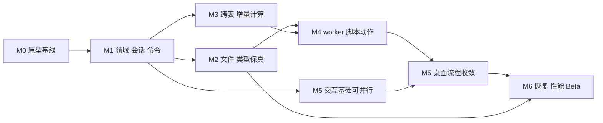

# QuickExcel 实施计划

本计划从现有可运行原型 M0 出发，以 Windows x64 Beta 为交付目标。先建立文档、类型与计算正确性，再开放工作进程脚本和完整桌面编辑流程。M1–M6 均为待实施任务；本文不会把设计完成计为功能完成，也不以日历期限代替质量门槛。

## 1. 里程碑与关键路径

关键路径是：类型/修订契约 → 格式与计算适配 → worker 及动作提交 → 桌面流程联调 → 恢复与发布。M2、M3 可在 M1 契约稳定后并行；M5 的 ViewModel 和交互基础可以提前进行，但不能在格式、计算和脚本能力未完成时宣布 M5 通过。测试、性能测量和 CI 随每阶段推进，M6 负责收敛证据，不承担所有测试的首次建设。

| 阶段 | 可交付给试用者的结果 | 进入条件 | 退出条件 |
| --- | --- | --- | --- |
| M0 当前原型 | 编辑、同表公式、QuickJS UDF、XLSQ v1 和 XLSX 快照导出 | 已有实现 | 记录现有证据和限制；不宣称完整 Excel 兼容 |
| M1 领域/会话/命令 | 原型行为保持，编辑与撤销通过统一入口，旧计算不覆盖新输入 | 固定 M0 示例与回归证据 | 类型/身份/修订契约冻结；事务、历史、会话测试通过 |
| M2 文件/类型 | 支持矩阵内 XLSX 类型保真、XLSQ v2、明确的迁移和损失报告 | M1 一致快照与类型模型 | v1/v2 往返、类型日期、预算、关系与原子保存测试通过 |
| M3 计算 | 跨表公式、结构引用更新、增量重算与缓存有效性 | M1；文件夹具与 M2 协作 | 增量结果等价于全量参考；错误/循环/取消/导出闭包正确 |
| M4 worker/脚本/动作 | 可终止的独立脚本执行，批量 UDF、模块和单步撤销的操作脚本 | M1 命令；M2 脚本包；M3 typed bridge | 崩溃不损坏文档；过期结果不提交；动作全有或全无；完成 OS 隔离策略原型 |
| M5 桌面体验 | 连贯的键盘编辑、多选、排序筛选、样式与脚本工作流 | M1；核心流程逐项依赖 M2–M4 | 主要试用路径、IME、无障碍、错误定位与兼容提示通过 |
| M6 Beta | 自动恢复、可复现构建、明确兼容范围和可安装发布包 | M1–M5 退出；恢复功能依赖 M2 保存协议 | 质量门禁、OS 隔离结论、性能实测、干净环境验收与发布说明齐备 |

各阶段先提供内部候选，再依据退出条件决定是否提供试用包。预算目标见 [质量与交付](06-quality-performance-and-delivery.md)，数值调整必须记录基准与原因，不能为了“通过”删除失败场景。

## 2. 任务编号与责任边界

本文件维护实施顺序和跨模块交付。`FMT-*` 的格式契约以 [文件专题](03-file-format-and-compatibility.md) 为准；`JS-*` 的脚本契约以 [运行时专题](04-scripting-and-runtime.md) 为准；`QA-*` 的判定与证据以 [质量专题](06-quality-performance-and-delivery.md) 为准。下面的责任方是模块角色，不代表已经分配给某位成员。

任务状态统一为待开始、进行中、待验收、完成或延期。只有实现、验收证据、文档三者一致才标记完成。大型任务可拆子任务，但不能因一部分合入而关闭父任务。依赖只使用任务或里程碑 ID，不依赖模糊的“先做完后端”。

## 3. M0：固定原型基线

M0 已有可试用程序，但仍需在后续开发起点固定可追溯证据。不得把本轮文档中的未来验收要求视作 M0 已通过。

| ID | 工作 | 输出与验收 |
| --- | --- | --- |
| BASE-001 | 固定源码与构建环境信息 | 保存 SDK、引擎 pin、native 构建参数、发布模式及示例文件哈希；能找到对应源码状态 |
| BASE-002 | 归档关键行为夹具 | 演示计算、脚本启停、稀疏 XLSX、XLSQ v1、导出快照；记录已知类型与跨表限制 |
| BASE-003 | 建立当前与目标能力表 | 将现有 21 个 Core 用例、native smoke、WPF smoke 的证据与未来验收分开；失败不可静默排除 |

格式和运行时现状分别关联 FMT-001、JS-001。已有记录可复用；只有源码或环境变化时才补跑相关基线，不反复执行无关全量验证。

## 4. M1：领域、会话与命令

责任方：领域/应用层主导，UI、存储和脚本适配配合。过渡期间保留 `WorkbookDocument` facade，使现有窗口按功能逐项接入新接口。

| ID | 任务 | 前置 | 输出与验收 |
| --- | --- | --- | --- |
| DOM-001 | 带类型的值、内容与计算结果 | BASE-002 | Blank/Text/Number/Boolean/Error 区分；公式与缓存分离；数值有限性和日期系统明确 |
| DOM-002 | 稀疏存储、稳定 SheetId 与快照 | DOM-001 | 远端编辑不分配所有空格；快照不会被后续编辑改变；身份在改名/重排中保持 |
| APP-001 | DocumentSession 与单写入队列 | DOM-002 | 每次打开独立 session；统一 Revision 与关闭生命周期；所有写入可追踪 |
| CMD-001 | Set/Paste/Clear 的预检与事务 | APP-001 | 一个非法地址使整批失败；粘贴形成一条历史；通知与模型内容一致 |
| CMD-002 | Undo/Redo 与历史预算 | CMD-001 | 恢复类型、公式、缓存状态；Revision 单调递增；截断策略可见 |
| APP-002 | 计算快照和代次提交门禁 | APP-001 | 假调度器倒序返回、关闭重开、源码变化时旧结果均被丢弃 |
| APP-003 | 存储/计算/脚本端口与组合根 | APP-001 | Core 不构造 WPF/native 对象；旧实现由适配器接入；进程内取消限制如实暴露 |
| UI-001 | 编辑提交控制器与最小 ViewModel | CMD-002、APP-003 | 单元格/公式栏/粘贴/保存均走同一编辑提交流程；待提交编辑不会丢失 |

关联 FMT-002、JS-002/003、QA-DOM-01、QA-CMD-01、QA-SES-01。项目拆分按编译边界逐步进行，不先创建大量空项目。M1 完成后 UI 仍可保持原型外观，但不能绕过会话直接修改 `XlCell`。

## 5. M2：文件与类型保真

责任方：存储适配主导。读取时先获得独立领域快照，完整校验后再交给会话；失败不得破坏当前打开的文档。

| ID | 任务组 | 前置 | 输出与验收 |
| --- | --- | --- | --- |
| FMT-003 | XLSQ v2、版本校验与 v1 迁移 | M1 | 唯一 XLSX 内容来源、稳定表身份、状态元数据；迁移不执行脚本、不覆盖原文件 |
| FMT-004 | XLSX 类型、日期与样式适配 | DOM-001/002 | 文本 `00123`、布尔、错误、空白/空文本、1900/1904 逐项往返；历史丢失类型不猜测恢复 |
| FMT-005 | ZIP/XML/JSON 预算与关系解析 | FMT-003 | 限额在分配/解压前后执行；路径、重复条目、外部关系和取消都有确定结果 |
| FMT-006 | 已知/未知部件目录与损失报告 | FMT-004/005 | 可保留条目字节不变；编辑使未知依赖失效时提前报告，不以复制 ZIP 冒充无损 |
| IO-001 | 保存协调器接入新快照 | APP-003、FMT-003 | 只标记成功保存的 captured Revision；保存期间新编辑仍为 dirty；失败保留上次成功文件 |
| JS-004 | 脚本元数据持久化 | FMT-003 | 保存源码/API/模块声明；打开、迁移、恢复均不带入运行授权 |

此阶段完成 QA-TYP-01、QA-FMT-01、QA-ZIP-01 和基础 QA-SAVE-01。M2 可以识别和保存模块清单，模块执行由 FMT-008 在 M4 实现；读取能力与执行能力分别报告。M2 不以“能打开”代替“编辑后能保真保存”。

## 6. M3：跨表与增量计算

责任方：计算模块主导，领域与存储配合。复用已验证的语法和函数实现，替换字符串强制转换及全局事件驱动的调度路径。

| ID | 任务 | 前置 | 输出与验收 |
| --- | --- | --- | --- |
| CALC-001 | AST 适配、名称绑定与 typed evaluator | DOM-001/002 | 单元格/区域/名称/工作表引用统一；显式转换、懒求值和错误传播符合支持矩阵 |
| CALC-002 | 工作簿依赖索引与完整重算 | CALC-001 | 跨表链正确；强连通分量定位循环；依赖循环的下游错误可区分；取消不发布半批结果 |
| CALC-003 | 增量失效和计算计划 | CALC-002、APP-002、JS-010 的 M3 契约 | 确定性标准公式只计算受影响闭包，随机编辑序列等价于全量参考；含 JS 工作簿先重建上下文并按稳定顺序完整重算，不复用 UDF/下游结果 |
| CALC-004 | 结构引用变换 | CALC-001、CMD-002 | 插入/删除/移动/表改名更新相对、绝对、混合及跨表引用；撤销可还原语义 |
| CALC-005 | 结果状态与诊断聚合 | CALC-002、APP-002 | 错误值、新鲜度、阻塞和旧缓存分别表达；错误可定位；禁用脚本不把缓存当新结果 |
| JS-005/006 | 类型桥接与函数描述符 | CALC-001 | v1 一维区域不变；v2 二维区域显式选择；命名空间解析、注册冲突和错误类型有契约测试 |
| JS-010（契约部分） | 先冻结 UDF 调度与纯度边界 | CALC-001、JS-005 | 在 CALC-003 前明确保守完整重算与上下文重建；全量/增量等价承诺限定确定性子集，不声称任意 JS 天然纯净 |
| FMT-007 | 缓存落盘和可移植公式导出 | CALC-002/003、M2 | JS 种子及跨表传递依赖冻结为值；独立受支持公式可保留；旧结果必须明确处理 |

验收以 QA-CALC-01 和乱序返回测试为主，不能只用截图观察几个结果。现有 ExcelIO.Formula 的回归先分类；不支持的 Excel 行为明确标记，不能为了通过旧用例继续污染新类型模型。结构编辑 UI 可在 M5 接入，但引用变换必须先有独立领域验证。

## 7. M4：worker、脚本模块与操作

责任方：脚本运行时主导，计算/应用层配合。开发测试可以使用进程内适配器，但交付的 worker 路径失败时不得静默退回同进程执行。

| ID | 任务组 | 前置 | 输出与验收 |
| --- | --- | --- | --- |
| JS-007 | worker、握手与帧协议 | APP-003、JS-003/005 | 每文档按需进程，串行 runtime；消息限额、身份与代次检查、反压和有界日志 |
| JS-008 | 真正取消、看门狗与故障恢复 | JS-007 | 无限循环/崩溃/管道中断不阻塞 UI；终止后不复用句柄；未提交操作不重放 |
| FMT-008 | 源码模块映射、加载及动作能力扩展 | M2、JS-007 | 只解析包内模块；增加 script-actions 必需能力、API v2 与 actions 绑定；旧读取器拒绝误读；不开放文件或网络 loader |
| JS-009 | 只读快照与动作 patch | CMD-002、JS-007、FMT-008 | 宿主二次验证 baseRevision/权限/容量；原子提交、一次撤销；冲突拒绝；保存重开动作绑定但不运行 |
| JS-010（实现部分） | worker 严格策略与确定性验证 | M3 执行契约、JS-007 | 隐藏依赖/可变闭包等反例有测试；不以冻结全局对象宣称函数纯净；通过策略验证前继续保守完整重算，不复用 UDF 结果 |
| SEC-001 / JS-014 | OS 隔离与部署可行性原型（同一任务的安全与运行时索引） | JS-007/008 | 评估受限令牌、Job Object、AppContainer/访问策略；实测文件/网络拒绝能力与运行库加载；形成 ADR 结论 |

完成 QA-JS-01、QA-WRK-01 和隐私行为测试。SEC-001 给出可行方案与取证，不等于 QA-OS-01 最终放行；OS 策略必须在 M6 对实际发布包验证。若策略仍未通过门禁，只继续提供明确限定可信脚本的试用候选，不算完成 M6 Beta；具体限制公开记录，不自动扩大信任范围。

## 8. M5：桌面交互收敛

责任方：桌面层主导。先补交互规则和网格适配接口，再以数据验证是否需要替换 WPF DataGrid。UI 不承担重新实现计算或存储规则的职责。

| ID | 任务 | 前置 | 输出与验收 |
| --- | --- | --- | --- |
| UI-002 | IGridSurface、虚拟化和性能 spike | UI-001、DOM-002 | 测量可见区域渲染、滚动、内存与选择成本；形成保留/替换 DataGrid 的 ADR |
| UI-003 | 键盘、选区、剪贴板和编辑状态机 | UI-001 | Enter/Tab/Escape/F2、矩形选择、IME、公式栏与撤销语义一致；外部文本公式按输入策略处理 |
| UI-004 | 结构、排序筛选、冻结与基础样式 | CALC-004、CMD-002 | 所有写操作经命令；排序引用语义与合并冲突明确；筛选不删除数据；原始值和显示值分离 |
| UI-005 | 工作区、文件生命周期与最近文件 | IO-001 | 新建/打开/另存/关闭、外部文件冲突提示、dirty 标识、快捷键和焦点均可预测 |
| JS-011 | 脚本编辑、启用、停止和诊断 | M4 | 源码变化停用旧代次；语法与运行错误定位；日志有界；用户能识别旧结果 |
| FMT-009 | 迁移、兼容与导出选择 | M2、FMT-007 | 显示具体受影响工作表/能力；取消无副作用；快照/可移植公式模式易于理解 |
| UI-006 | 无障碍与恢复流程原型 | UI-003/005 | 键盘可到达、读屏名称、缩放/高 DPI；恢复 UI 与持久化契约对齐，完整恢复验收留到 M6 |
| UI-007 | 查找替换与多区域选择规则 | CMD-002、UI-003 | 区域/当前表/工作簿范围与值/公式搜索显式选择；全部替换一条事务；不连续目标的复制粘贴有明确拒绝或映射规则 |
| UI-008 | 基础图片与合并呈现 | FMT-004/006、UI-002、CALC-004 | 支持矩阵内图片可见、保存重开保持；行列变更同步锚点/合并/选区；未支持锚点不允许无提示破坏 |

QA-UI-01 覆盖实际 WPF 编辑和保存路径；QA-UI-02 覆盖查找替换、排序筛选、结构变换与图片呈现，不以领域用例代替交互验收。完整脚本调试器、Excel 功能区复制、图表/透视表设计器不属于此阶段。若网格替换风险过高，先采用已达到预算的交互范围，并在支持矩阵公开限制。

## 9. M6：恢复、性能与 Beta 发布

责任方：存储与交付角色联合负责；质量门禁由各模块提供可复现证据。

| ID | 任务组 | 前置 | 输出与验收 |
| --- | --- | --- | --- |
| FMT-010 | 自动保存、冲突检测和恢复 | IO-001、UI-006 | 同目录原子保存与独立恢复草稿；按格式专题的 30 秒触发/60 秒窗口提议测量并冻结预算；滞后提示；冲突不静默覆盖；恢复不执行代码；故障注入验证最后成功版本 |
| REL-001 | 基准与性能收敛 | 从 M1 持续建立 | 固定工作负载、机器和采样；记录 p95/内存；取消、滚动、计算、保存达成已批准预算 |
| REL-002 | 分层 CI 与可复现源码构建 | 从 BASE-001 持续建立 | 原库回归、Core、native、UI、畸形输入和发布验证分层；SDK/源码/hash/编译参数可追溯 |
| JS-012 | 发布包 OS 策略验证 | SEC-001、M4 | QA-OS-01 证据包含被攻陷 worker 的系统调用限制；形成准确发布声明与未解决项 |
| JS-013 | 原生升级与依赖清单 | REL-002 | QuickJS 来源、许可证、补丁、升级回归和崩溃诊断过程可执行 |
| REL-003 | 安装/便携分发与干净机器验收 | REL-001/002、FMT-010 | 明确 framework-dependent 或 self-contained；包内 DLL/许可证齐全；无 SDK 机器打开/编辑/保存通过 |
| REL-004 | Beta 发布清单与反馈入口 | 全部退出门禁 | 已验证功能矩阵、已知问题、迁移与备份说明、版本/日志导出和故障复现模板；支持退回旧程序而不覆盖新格式原件 |

最终门禁包括 QA-REC-01、QA-PERF-01、QA-CI-01、QA-SUP-01、QA-REL-01，以及前序全部适用质量项。恢复后端与完整流程在本阶段交付，M5 的恢复界面原型不视作已经防止数据丢失。测试或性能未达标时修复、缩减公开范围或延期，不用“Beta”标签隐去限制。

## 10. 下一轮可直接执行的变更切片

以下是建议实施顺序，尚未执行或创建 PR。每个切片保持主干可构建、原型可试用；本地分支如需创建，使用 `codex/` 前缀。

1. **基线与契约**：整理 BASE-001/002/003；引入 DOM-001；仅做值类型/日期/错误的语义测试。先不改窗口布局。
2. **稀疏快照与适配**：DOM-002；旧 `XlWorkbook` 与领域模型双向适配，仅覆盖当前行为；明确旧字符串类型损失。
3. **会话与编辑事务**：APP-001、CMD-001；把单格编辑和粘贴切到新入口，验证非法粘贴整批回滚。
4. **历史与待提交编辑**：CMD-002、UI-001；验证保存前提交编辑，以及撤销公式时恢复依赖和缓存状态。
5. **代次与运行时门面**：APP-002/003、JS-002/003；通过可控乱序调度测试后接入真实 QuickJS。
6. **M1 放行**：检查每条写路径均通过会话，回归原型打开/编辑/启用脚本/保存/重开流程；随后并行开始 M2 与 M3。

这些切片的大小以独立可验收为准，不按文件数量划分。若一个切片无法在保持旧路径可用的情况下完成，就先引入适配层和行为契约，再迁移调用方。禁止长期同时保留两个都能提交结果的计算调度器。

## 11. 并行协作与变更管理

| 工作流 | 可并行边界 | 需要先冻结的契约 |
| --- | --- | --- |
| 领域/会话 | 核心命令与存储适配夹具可协作 | CellValue、SheetId、Snapshot、ChangeSet、Revision |
| 文件/计算 | M2 与 M3 可并行；各自使用相同领域夹具 | 日期系统、Error、公式缓存状态、解析失败语义 |
| 计算/脚本 | 解析与 worker 管道可并行 | TypedValue、函数描述符、完整身份元组、取消/超时 |
| UI/核心 | ViewModel、键盘和诊断界面可提前 | 编辑提交、状态通知、命令结果与兼容性报告 DTO |
| 质量/交付 | 每阶段同步补测试/基准/CI | 支持矩阵、工作负载版本、可重现数据生成器 |

重大格式/API 更改先更新专题和 ADR，再改实现与夹具。临时功能开关只用于适配切换，不用于绕过文件校验、代次检查或权限策略。新存储格式写入必须显式升级；失败退回原型时只读原始 v1 备份或兼容 XLSX 副本，不让旧程序覆写 v2 文件。

每阶段验收记录包含：源码标识、环境、执行命令、夹具版本、实际结果、已知偏差与复现方式。通过标准不要求没有所有缺陷，但任何数据丢失、过期结果覆盖、新旧类型混淆和未授权脚本执行均阻挡相关功能放行。

## 12. 风险与决策截止点

| 风险或待验证项 | 处理方式 | 决策时间 |
| --- | --- | --- |
| ExcelIO 字符串模型无法完整保存类型 | 保留原库公共兼容性，通过适配和最小扩展支持 typed 数据；不要求桌面反向迁就错误模型 | M1 契约完成、M2 适配前 |
| 旧解析器不支持命名空间/跨表细节 | 先做语法夹具，必要时扩展 AST；只公开已验证公式集合 | M3 typed evaluator 接口冻结前 |
| 未知 XLSX 部件失效难判定 | 保守失效报告、另存受支持子集；不承诺任意文件无损编辑 | M2 支持矩阵发布前 |
| UDF 可变状态破坏增量结果 | M3 先定义含 JS 工作簿每轮重建上下文与完整重算；严格策略验证前不复用 UDF/下游结果 | JS-010：M3 契约、M4 实现 |
| Windows OS 隔离方案与 native 加载冲突 | 对实际 DLL/运行库/管道做原型；若未通过，只发布可信脚本试用定位 | M4 SEC-001、M6 最终复核 |
| WPF DataGrid 大表体验不足 | 固定基准 spike 后决定自绘/替代控件；计算与存储不绑定控件 | M5 UI-002 |
| 工期被功能扩张吞没 | 优先关闭数据正确性与持久化风险；后续范围单独排期 | 每个里程碑入口 |

决策记录见 [架构决策](07-architecture-decisions.md)。本轮不估算未经实施验证的完成日期；M1 完成后，以实际吞吐和未解决风险形成滚动排期，再给出后续迭代的可信时间范围。
